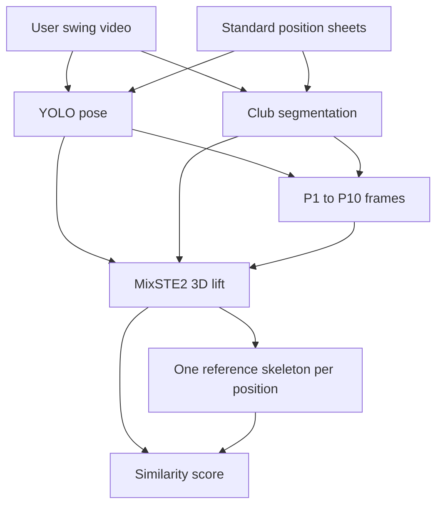

# Golf posture workflow

This file describes the current program: how a swing video becomes ten pose pictures, and how those pictures are scored against the standard positions.

The models already in the project do the work. Pose is YOLO26n-pose. The club is the trained YOLO segmentation model. The 3D skeleton is the GolfPose 17+2 MixSTE2 checkpoint. Angles and scores are NumPy. Nothing new is trained.

## What the program is made of

| Piece | Role |
| --- | --- |
| `predict_pose.py` | Pose on still images. The first experiment. |
| `prepare_golf_club_seg.py`, `train_golf_club_seg.py`, `predict_seg.py` | Build and run the golf-club segmentation model. |
| `trace_swing_plane.py` | Smoothed 2D clubhead path and the clubface angle at the top and at impact. |
| `swing_phases.py` | Address, top, impact, follow-through, and the ten P positions. |
| `golf_pose_3d.py` | 2D pose and club, then the 3D lift, the ten stills, and the ball. |
| `standard_frames.py` | The ten standard sheets, three cameras each, merged into one reference skeleton. |
| `score_swing.py` | Compare one lifted swing with other lifted swings. |
| `compare_standard_frames.py` | Compare one lifted swing with the ten standard skeletons. |

`third_party/golfpose/` is the MixSTE2 network. `golfpose_checkpoints/` holds the 17+2 weights.

## Workflow



### 1. Read the swing

`golf_pose_3d.py` takes a video from `user_swings/`. On each frame it finds the golfer and the club. The club mask is split into a grip and a clubhead. Those two points become the extra joints `shaft` and `hosel`. The body joints are converted from COCO order into the 19-joint GolfPose order.

The ball, when the existing YOLOE model finds it, marks the address position and the frame where the clubhead passes the ball.

### 2. Choose the ten frames

`swing_phases.py` names the frames. The names follow the [HackMotion P list](https://hackmotion.com/golf-swing-positions/).

- P1 is address, P4 is the top, and P7 is the clubhead closest to the ball after the top.
- P3 is the first time the lead arm is near the ground on the way back.
- P2, P6, and P8 are the frames where the shaft is closest to the ground, each one sitting between its two neighbors.
- P5 is the first time the shaft is near the ground on the way down, while the hands are still high.
- P9 is the lead arm closest to the ground after impact. P10 is the hands nearest the lead side of the head after that.

“Near the ground” uses the 3D view. The picture’s floor is its XY plane. A bone parallel to that floor has a small up-component.

### 3. Lift the skeleton

MixSTE2 turns the 2D joints into a 3D skeleton. The camera axes are X right, Y down, and Z forward. The drawn view swaps those axes so the floor lies on the picture plane. A short clip is padded by repeating the last frame until the network’s 243-frame window is full.

The 3D clubhead path is the lifted hosel joint over time. It is not a copy of the smoothed 2D curve.

### 4. Build the standard poses

Each file in `pro_refs/Standard_10_frames/` is one perfect position shown from three cameras: face-on, down-the-line, and rear. `standard_frames.py` crops the three photos, runs pose and club segmentation on each, and lifts each photo by repeating that single frame.

The down-the-line lift is the anchor. Face-on is rotated about the vertical axis until its bones agree with that anchor. The saved `reference_3d` skeleton is the average of those two. The rear view is kept as its own picture and is not part of the average.

### 5. Score a user swing

`compare_standard_frames.py` reads the user’s 3D pose at each P frame and the matching `reference_3d`. Both are centered on the hips and scaled by the spine length. The user pose is rotated in 15-degree steps about the vertical axis, with no mirror, and the closest heading is kept. That removes a difference in camera heading.

Each checked bone is a unit vector. The score is `(cosine + 1) / 2 * 100`, so a matching direction is 100. A wrist angle, when the checklist asks for one, scores 100 when the two angles match. Every parameter that both sides can supply has the same weight. A missing frame is left out. The face angle is not used here, because the standard sheets do not have one.

`score_swing.py` is the other comparison. It scores one lifted video against other lifted videos, and it also reports a separate clubhead-path score. That path score is not part of the standard-pose total.

## Where the files go

```text
runs/golf_pose_3d/<swing>/
  <swing>_3d.avi          side-by-side 2D and 3D video
  <swing>_3d.npz          2D and 3D joints
  <swing>_3d.json         phases, P frames, ball, wrist angles
  P1.jpg ... P10.jpg      labeled source frames
  standard_compare/
    P1_user_3d.jpg        user skeleton in the shared 3D space
    P1_vs_reference.jpg   user skeleton beside the standard
    score.json            total and per-position scores

runs/standard_frames/<position>/
  face_on_labeled.jpg
  down_the_line_labeled.jpg
  rear_labeled.jpg
  *_3d.jpg                one camera’s lift
  reference_3d.jpg        face-on and down-the-line average
  joints.json
  joints.npz              reference_3d and the per-camera joints
```

## Commands

```powershell
python golf_pose_3d.py user_swings\<swing>.mp4
python standard_frames.py
python compare_standard_frames.py runs\golf_pose_3d\<swing>
python score_swing.py --standards runs\golf_pose_3d\<reference> --user runs\golf_pose_3d\<swing>
```

The first command finds the ten user frames and writes the 3D video. The second builds the standard skeletons. The third writes the similarity score against those standards. The fourth compares two videos that have both already been lifted.
